<div align="center">



<a href="https://gabrielsantosdev.com">

</a>

<br/>

<a href="https://gabrielsantosdev.com"></a>
&nbsp;
<a href="mailto:gabrielsantosgithubac@gmail.com"></a>

</div>

<br/>

<h2 align="center">👨‍💻 About Me</h2>

<p align="center">
I'm a <b>Full-Stack Developer</b> and <b>Computer Science student at Una Betim</b>,<br/>
focused on building software that is reliable, maintainable and solves real problems.
</p>

```json
{
  "role": "Full-Stack Developer",
  "studying": "Computer Science @ Una Betim",
  "current_stack": ["PHP", "Laravel", "Java", "Spring Boot"],
  "goal": "Build reliable, purposeful software"
}
```

<br/>

<h2 align="center">🛠️ Tech Stack</h2>

<div align="center">

<table>
  <tr>
    <td align="center" colspan="5"><code>&gt;_ languages</code></td>
  </tr>
  <tr>
    <td align="center" width="110"><br/><sub><b>Java</b></sub></td>
    <td align="center" width="110"><br/><sub><b>PHP</b></sub></td>
    <td align="center" width="110"><br/><sub><b>JavaScript</b></sub></td>
    <td align="center" width="110"><br/><sub><b>Python</b></sub></td>
    <td align="center" width="110"><br/><sub><b>SQL / PL-SQL</b></sub></td>
  </tr>
  <tr>
    <td align="center" colspan="5"><code>&gt;_ frameworks &amp; back-end</code></td>
  </tr>
  <tr>
    <td align="center" width="110"><br/><sub><b>Laravel</b></sub></td>
    <td align="center" width="110"><br/><sub><b>Spring Boot</b></sub></td>
    <td align="center" width="110"><br/><sub><b>Next.js</b></sub></td>
    <td align="center" width="110"><br/><sub><b>Composer</b></sub></td>
    <td align="center" width="110"><br/><sub><b>Maven</b></sub></td>
  </tr>
  <tr>
    <td align="center" colspan="5"><code>&gt;_ front-end &amp; styling</code></td>
  </tr>
  <tr>
    <td align="center" width="110"><br/><sub><b>HTML5</b></sub></td>
    <td align="center" width="110"><br/><sub><b>CSS3</b></sub></td>
    <td align="center" width="110"><br/><sub><b>React</b></sub></td>
    <td align="center" width="110"><br/><sub><b>Tailwind</b></sub></td>
    <td align="center" width="110"><br/><sub><b>Bootstrap</b></sub></td>
  </tr>
  <tr>
    <td align="center" colspan="5"><code>&gt;_ databases &amp; tools</code></td>
  </tr>
  <tr>
    <td align="center" width="110"><br/><sub><b>MySQL</b></sub></td>
    <td align="center" width="110"><br/><sub><b>PostgreSQL</b></sub></td>
    <td align="center" width="110"><br/><sub><b>Oracle</b></sub></td>
    <td align="center" width="110"><br/><sub><b>Git</b></sub></td>
    <td align="center" width="110"><br/><sub><b>GitHub</b></sub></td>
  </tr>
</table>

</div>

<br/>

<h2 align="center">🚀 What Drives Me</h2>

<div align="center">

<table>
<tr>
<td align="center" width="380">
<h3>🔧 Clean code with purpose</h3>
<sub>Readable, maintainable and built to solve real problems.</sub>
</td>
<td align="center" width="380">
<h3>📚 Always learning</h3>
<sub>A Computer Science student with a builder's mindset.</sub>
</td>
</tr>
<tr>
<td align="center" width="380">
<h3>🧱 Real-world projects</h3>
<sub>Growing as a full-stack developer by shipping things that work.</sub>
</td>
<td align="center" width="380">
<h3>🧩 Problem solver</h3>
<sub>Every challenge is a chance to learn something new.</sub>
</td>
</tr>
</table>

</div>

<br/>

<h2 align="center">📊 GitHub Stats</h2>

<div align="center">

<a href="https://github.com/GabrielSSGitb">

</a>
<a href="https://github.com/GabrielSSGitb?tab=repositories">

</a>

<br/>

<a href="https://github.com/GabrielSSGitb">

</a>

<br/>


</div>

<br/>

<h2 align="center">📫 Let's Connect</h2>

<p align="center">
I'm open to collaborations, opportunities and good conversations about software.
</p>

<p align="center">
<a href="https://gabrielsantosdev.com"></a>
&nbsp;
<a href="mailto:gabrielsantosgithubac@gmail.com"></a>
</p>

<br/>

<div align="center">

<sub><code>// Building my path in tech, step.by.step()</code></sub>


</div>
